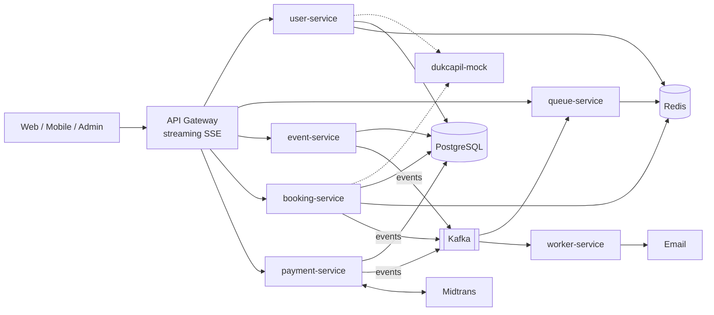

# Rusuh Booking Tiket

Sistem pemesanan tiket konser online yang dirancang untuk **flash crowd**: ratusan ribu orang datang di detik yang sama
untuk stok yang jauh lebih kecil. Fokusnya bukan sekadar CRUD booking, tapi menjaga sistem **stabil, adil (FCFS),
dan tidak memutus journey** pengguna saat beban puncak.

| | |
|---|---|
| Base URL API (production) | `https://rusuh-gateway-stream-381331776726.asia-northeast1.gateway.dev` (wajib `https://`) |
| Dokumentasi | [`docs/`](docs) — PRD, HLD, LLD, ERD, OpenAPI, sequence diagram, local setup |
| Jalankan di laptop | [docs/LOCAL-SETUP.md](docs/LOCAL-SETUP.md) |

---

## Ringkasan

Dua prinsip yang tidak bisa ditawar:

1. **Lindungi layanan inti.** Waiting room virtual menahan lonjakan; hanya sejumlah orang yang boleh masuk ke booking room.
2. **Jangan PHP** (jangan memberi harapan palsu). Jumlah orang di booking room dibatasi `floor(stok / 3)`, sehingga
   setiap orang yang sudah masuk **dijamin** kebagian tiket bila submit dalam 5 menit.

Pembeli tidak wajib login (pola KAI): cukup mengisi data penonton (dicocokkan ke Dukcapil tiruan) dan email.
Satu kode booking maksimal 3 tiket, **1 tiket = 1 NIK**, dan satu NIK hanya boleh 1 tiket per event.

---

## Fitur

**Customer**
- Daftar event (available / sold out) dan detail kategori tiket.
- **Waiting room** FCFS dengan posisi & estimasi waktu tunggu realtime (**SSE**); refresh tidak kehilangan posisi.
- **Stok realtime** di halaman detail tiket (**SSE**).
- Booking ≤ 3 tiket dengan validasi NIK (nama, tanggal lahir, nama ibu) ke Dukcapil tiruan.
- TTL server-authoritative: 5 menit memilih tiket, 10 menit membayar; tombol back dinonaktifkan saat sisa < 30 detik.
- Pembayaran **Midtrans Snap** (VA, QRIS, e-wallet), halaman bayar yang sama untuk web dan mobile (WebView).
- **Cancel booking** dari Payment Page: stok kembali, transaksi Midtrans di-expire, user antri ulang.
- Email: instruksi bayar, **e-tiket**, dan pembatalan (async, dengan retry & dead-letter).
- Login opsional: simpan daftar NIK keluarga (member), riwayat tiket.

**Admin**
- CRUD event & kategori tiket.

**Sistem**
- Anti-oversell: hold stok atomik di PostgreSQL + `CHECK (available >= 0)`.
- Kuota NIK atomik (lock per NIK), callback pembayaran **idempoten** + verifikasi signature.
- Antrian ditutup otomatis saat sold out, pengguna di antrian diberi tahu lewat SSE.
- Queue cap ("ramai, coba lagi") terpisah dari sold out; rate limit di titik rawan (join, login, register, verifikasi NIK).

---

## Arsitektur (HLD singkat)

- **Stateless** di Cloud Run (auto-scale), **stateful** terpusat & atomik: PostgreSQL (source of truth), Redis (antrian, token, Pub/Sub realtime), Kafka (event antar service).
- Hal non-kritikal (email) **async**; kegagalannya tidak membatalkan transaksi.

Detail: [docs/HLD.md](docs/HLD.md).

## Desain service (LLD singkat)

Setiap service: Go, **arsitektur hexagonal** (port & adapter), `net/http` standar, envelope response `{status, message, data}`.

| Mekanisme | Implementasi |
|---|---|
| Waiting room | Redis Sorted Set per event + skrip **Lua atomik** (join, promosi bergelombang, release, sweep tiap 1 detik) |
| Kapasitas booking room | `CapByStock = stok ≤ 3 ? 1 : floor(stok/3)` (dibatasi plafon global), identik di Go & Lua |
| Hold stok | `UPDATE ... SET available = available - n WHERE available >= n` dalam satu transaksi |
| Kuota NIK | `pg_advisory_xact_lock` per (event, NIK) + hitung tiket `HELD/PAID` |
| Token | Login JWT (opsional), Access Token antrian (5 menit), Payment Token (10 menit) — HS256, secret berbeda |
| Callback | Signature SHA-512 + cek `gross_amount` + tabel idempotensi `order_id:transaction_status` |
| Email | Kafka → worker, retry topic (5s/10s/20s) → dead-letter topic |

Detail: [docs/LLD.md](docs/LLD.md) · skema: [docs/ERD.md](docs/ERD.md) · alur: [docs/SEQUENCE-DIAGRAM.md](docs/SEQUENCE-DIAGRAM.md).

---

## Tech stack

| Area | Teknologi |
|---|---|
| Bahasa | Go 1.26 (`net/http`, `log/slog`) |
| Database | PostgreSQL 16 (pgx) |
| Cache / antrian / realtime | Redis 7 (Sorted Set, Lua, Pub/Sub) |
| Event streaming | Apache Kafka (segmentio/kafka-go) |
| Realtime ke klien | Server-Sent Events (SSE) |
| Payment | Midtrans Snap (sandbox) |
| Deploy | Google Cloud Run, API Gateway (streaming), VM data privat, Docker |
| Observability | OpenTelemetry → Cloud Trace, Cloud Logging |
| Kualitas | Go test + race detector, golangci-lint, gosec, govulncheck, SonarQube, GitHub Actions |

---

## Repository

| Repo | Peran | Port lokal |
|---|---|---|
| [user-service](https://github.com/refreshTechRusuh/user-service) | Auth (login opsional), member NIK, riwayat tiket, verifikasi NIK | 8086 |
| [queue-service](https://github.com/refreshTechRusuh/queue-service) | Waiting room, admission control, SSE posisi | 8084 |
| [dukcapil-mock](https://github.com/refreshTechRusuh/dukcapil-mock) | Mock validasi data kependudukan | 8085 |
| [event-service](https://github.com/refreshTechRusuh/event-service) | Katalog event, CRUD admin | 8082 |
| [booking-service](https://github.com/refreshTechRusuh/booking-service) | Hold stok, kuota NIK, cancel, SSE stok | 8081 |
| [payment-service](https://github.com/refreshTechRusuh/payment-service) | Midtrans Snap, callback idempoten | 8083 |
| [worker-service](https://github.com/refreshTechRusuh/worker-service) | Pengirim email (Kafka consumer) | 8080 |

---

## Menjalankan di lokal

Ringkasnya: clone 7 repo ke satu folder → `docker compose up -d` (PostgreSQL, Redis, Kafka, Mailpit; migrasi otomatis)
→ buat `.env` per service → jalankan 7 service → ikuti smoke test (admin buat event → antrian → booking → cancel → bayar → email di Mailpit).

Langkah lengkap, file compose, `.env`, dan perintah uji: **[docs/LOCAL-SETUP.md](docs/LOCAL-SETUP.md)**.

## Dokumentasi

| Dokumen | Isi |
|---|---|
| [PRD](docs/PRD.md) | Kebutuhan produk, business rules, catatan implementasi |
| [HLD](docs/HLD.md) | Arsitektur, komponen, keputusan desain |
| [LLD](docs/LLD.md) | Struktur kode, Redis keys, skrip Lua, transaksi, kontrak Kafka |
| [ERD](docs/ERD.md) | Skema PostgreSQL |
| [OpenAPI](docs/openapi.yaml) | Kontrak HTTP (impor ke Apidog/Postman/Swagger UI) |
| [Sequence diagram](docs/SEQUENCE-DIAGRAM.md) | Alur utama & alternatif |
| [Local setup](docs/LOCAL-SETUP.md) | Menjalankan & menguji di laptop |
