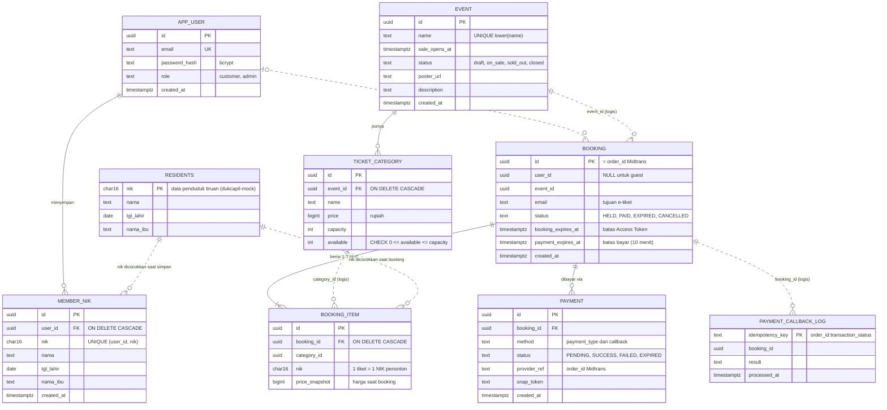

# ERD — Rusuh Booking Tiket

> Skema PostgreSQL (database tunggal `rusuh_booking`) persis seperti hasil migrasi di repo masing-masing service.
> Antrian dan token **tidak** disimpan di PostgreSQL, tapi di Redis (lihat [LLD.md §2.1](LLD.md#21-queue-service-8084)).

## Diagram

Garis putus-putus = relasi logis tanpa foreign key (tabel dimiliki service berbeda; konsistensi dijaga di aplikasi).

## Kepemilikan tabel

| Tabel | Ditulis oleh | Dibaca juga oleh |
|---|---|---|
| `app_user`, `member_nik` | user-service | — |
| `residents` | dukcapil-mock (seed) | — |
| `event`, `ticket_category` | event-service (CRUD), booking & payment (`available`) | queue-service (warm-up stok) |
| `booking`, `booking_item` | booking-service, payment-service (`status`) | user-service (riwayat) |
| `payment`, `payment_callback_log` | payment-service, booking-service (`PENDING → EXPIRED` saat cancel) | — |

## Index & constraint penting

| Objek | Fungsi |
|---|---|
| `ticket_category.available CHECK (available >= 0)` + `CHECK (available <= capacity)` | Lapis terakhir anti-oversell |
| `idx_booking_item_nik (nik)` + `idx_booking_event_status (event_id, status)` | Hitung kuota 1 tiket per NIK per event |
| `idx_booking_payment_expires (payment_expires_at) WHERE status='HELD'` | Sweeper booking kedaluwarsa |
| `payment_callback_log.idempotency_key` (PK) | Webhook Midtrans idempoten |
| `idx_event_name_unique (lower(name))` | Nama event unik tanpa membedakan huruf |
| `member_nik UNIQUE (user_id, nik)` | Satu user tidak menyimpan NIK yang sama dua kali |

## Catatan desain

| Keputusan | Alasan |
|---|---|
| `nik` di `booking_item`, bukan di `booking` | 1 tiket = 1 NIK; satu booking (≤ 3 tiket) bisa berisi beberapa penonton |
| `booking.user_id` nullable | Login opsional; guest membeli dengan email + data penonton |
| `price_snapshot` | Harga bisa diubah admin; tagihan mengikuti harga saat booking |
| `booking.id` = `order_id` Midtrans | Charge & callback idempoten tanpa tabel pemetaan |
| Migrasi tanpa auto-migrate | Dijalankan saat provisioning (lokal: init script Postgres, lihat [LOCAL-SETUP.md](LOCAL-SETUP.md)) |
