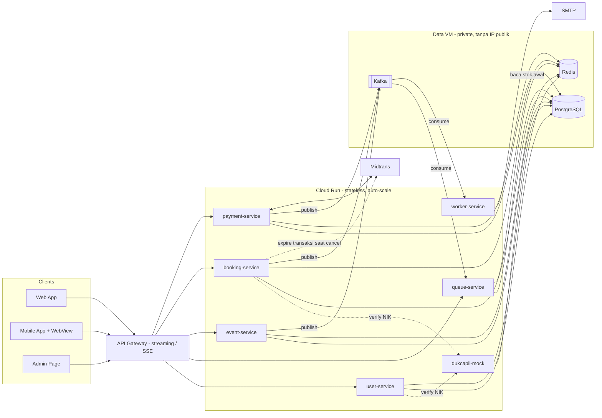
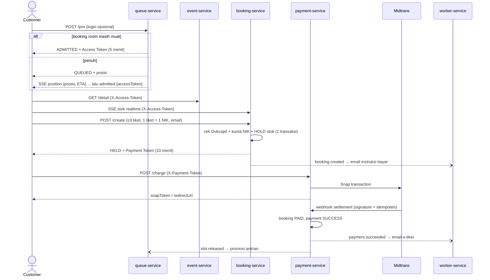

# HLD — Rusuh Booking Tiket

> High Level Design: arsitektur sistem, komponen, alur utama, dan keputusan desain.
> Detail per service ada di [LLD.md](LLD.md); kebutuhan produk di [PRD.md](PRD.md).

| Field | Nilai |
|---|---|
| Versi | 2.0 (mengikuti implementasi yang berjalan) |
| Tanggal | 13 November 2026 |

---

## 1. Masalah & prinsip

Penjualan tiket konser memicu **flash crowd**: ratusan ribu orang datang di detik yang sama untuk stok yang jauh lebih kecil.
Tantangannya bukan CRUD booking, tapi menjaga sistem **stabil, adil, dan tidak memutus journey**.

Dua prinsip yang tidak bisa ditawar:

1. **Lindungi layanan inti.** Waiting Room menjadi *admission control*: hanya sejumlah orang yang boleh masuk ke booking room, sesuai stok.
2. **Jangan PHP** (jangan memberi harapan palsu). Orang yang sudah masuk booking room **dijamin** kebagian tiket bila submit dalam batas waktu.

Turunannya:
- Layer aplikasi **stateless** dan auto-scale; state yang harus konsisten (stok, antrian) **terpusat dan atomik** di PostgreSQL + Redis.
- **Asinkron** untuk hal non-kritikal (email) lewat Kafka, sehingga kegagalannya tidak membatalkan transaksi.
- Semua batas waktu **ditegakkan server** (TTL di Redis & kolom `*_expires_at`); countdown di klien hanya tampilan.

---

## 2. Arsitektur sistem

| Lapisan | Pilihan | Alasan |
|---|---|---|
| Edge | **Google API Gateway** (dibuat dengan streaming aktif) | Satu host HTTPS untuk semua klien; streaming wajib agar SSE tidak di-buffer |
| Compute | **Cloud Run**, 1 container per service | Auto-scale horizontal untuk lonjakan, TLS bawaan, deploy dari image |
| Data | **1 VM privat**: PostgreSQL, Redis, Kafka (KRaft) | State butuh koneksi persisten & disk; diakses Cloud Run lewat Serverless VPC Connector |
| Payment | **Midtrans Snap** (sandbox) | Gateway lokal Indonesia; halaman bayar yang sama untuk web & mobile (WebView) |
| Email | SMTP (Gmail di cloud, Mailpit di lokal) | Dikirim worker secara async |

`dukcapil-mock` sengaja **tidak** dipasang di gateway: ia mensimulasikan pihak eksternal (Dukcapil) dan dipanggil antar service. Karena hanya mock, ia tidak memakai autentikasi.

---

## 3. Komponen & tanggung jawab

| Service | Tanggung jawab utama | State |
|---|---|---|
| **user-service** | Register/login/logout (login **opsional**), JWT, role `customer`/`admin`, CRUD member NIK (dicocokkan ke Dukcapil), verifikasi NIK, riwayat tiket, bootstrap akun admin | PostgreSQL, Redis (denylist refresh token, rate limit) |
| **dukcapil-mock** | Mencocokkan `{nik, nama, tglLahir, namaIbu}` ke data penduduk tiruan | PostgreSQL (`residents`) |
| **queue-service** | Waiting room FCFS, admission control (kapasitas booking room dari stok), terbit Access Token, ETA, SSE posisi, sweeper kursi kedaluwarsa, tutup antrian saat sold out | Redis (antrian), baca stok awal dari PostgreSQL |
| **event-service** | Katalog event (publik), detail event (butuh Access Token), CRUD event & kategori (admin) | PostgreSQL |
| **booking-service** | Validasi penonton ke Dukcapil, kuota 1 tiket/NIK/event, **hold stok atomik**, TTL, cancel, Payment Token, SSE stok realtime, sweeper booking kedaluwarsa | PostgreSQL, Redis (Pub/Sub stok, token antrian dicabut) |
| **payment-service** | Charge Midtrans Snap, detail pembayaran (web & WebView), webhook idempoten + verifikasi signature, sweeper payment kedaluwarsa | PostgreSQL, Redis (redirect URL) |
| **worker-service** | Konsumsi event Kafka → kirim 3 jenis email, retry + dead-letter | — |

---

## 4. Journey utama

Alur alternatif (cancel, TTL booking habis, TTL bayar habis, sold out, mobile WebView) ada di [SEQUENCE-DIAGRAM.md](SEQUENCE-DIAGRAM.md).

---

## 5. Keputusan desain kunci

### 5.1 Waiting room = admission control yang anti-PHP
- Antrian per event disimpan di **Redis Sorted Set**; score = nomor urut kedatangan → FCFS.
- Identitas antrian = **queue token** persisten (bukan session browser), sehingga refresh tidak kehilangan posisi.
- **Kapasitas booking room** (jumlah orang di dalam sekaligus) dihitung dari stok:
  `stok ≤ 0 → 0`, `stok ≤ 3 → 1`, selain itu `floor(stok / 3)`, dibatasi plafon `GLOBAL_BOOKING_CAP`.
  Karena tiap orang maksimal 3 tiket, total permintaan orang di dalam **tidak pernah melebihi stok** → hold saat submit pasti berhasil.
- Join, promosi, pelepasan kursi, dan sweep dijalankan sebagai **skrip Lua atomik** di Redis. Promosi dilakukan bergelombang dari depan antrian.
- **Queue cap** (`QUEUE_CAP`) membatasi panjang antrian: penuh → `503 QUEUE_FULL` (“ramai, coba lagi”), berbeda dari sold out (`410`).
- **ETA** = posisi ÷ laju admit (rolling 60 detik); disembunyikan bila laju belum terukur.

### 5.2 Anti-oversell
- Stok otoritatif di PostgreSQL: `UPDATE ticket_category SET available = available - n WHERE id = $1 AND available >= n` dalam transaksi; 0 baris → tolak.
- Kolom `available` punya `CHECK (available >= 0)` sebagai lapis terakhir.
- Kuota **1 tiket per NIK per event** dicek di transaksi yang sama, dengan `pg_advisory_xact_lock` per (event, NIK) agar dua request bersamaan tidak lolos.
- Pelepasan stok (expire/cancel) hanya terjadi bila status benar-benar berubah dari `HELD` (cek jumlah baris terpengaruh) → tidak ada pelepasan ganda.

### 5.3 TTL server-authoritative
| Batas | Durasi | Ditegakkan oleh |
|---|---|---|
| Access Token (pilih tiket) | 5 menit sejak admitted | `exp` JWT + Redis; sweeper queue melepas kursi tiap 1 detik |
| Pembayaran | 10 menit sejak booking dibuat | `booking.payment_expires_at`; sweeper booking (30 detik) & payment; expiry Snap disamakan |

### 5.4 Token & identitas
| Token | Penerbit | Dipakai untuk | Header |
|---|---|---|---|
| Login JWT (opsional) | user-service | Member, riwayat, admin; menautkan `user_id` ke booking. Berumur 1 jam, diperbarui lewat refresh token (7 hari) | `Authorization: Bearer` |
| Access Token | queue-service | Detail event, stok SSE, buat booking | `X-Access-Token` |
| Payment Token | booking-service | Status booking, charge, detail bayar, cancel | `X-Payment-Token` |

Ketiganya HS256 dengan secret **berbeda**. Guest bisa membeli tanpa login: identitas pembeli = data penonton (dicocokkan Dukcapil) + email + Access Token.

### 5.5 Realtime dengan SSE
- **Posisi antrian** dan **stok** sama-sama aliran satu arah server→klien → **SSE** untuk keduanya (satu teknologi, auto-reconnect bawaan).
- Antrian: perubahan dibangunkan lewat Redis Pub/Sub + pengecekan ulang tiap `QUEUE_SSE_TICK_SECONDS` (heartbeat).
- Stok: booking-service mem-publish perubahan ke Redis Pub/Sub; tiap koneksi SSE mengirim batch paling cepat tiap 1 detik.
- Lewat API Gateway, stream dibatasi **3570 detik**; klien wajib auto-reconnect.

### 5.6 Pembayaran idempoten
- `order_id` Midtrans = `bookingId`.
- Webhook diverifikasi `signature_key = sha512(order_id + status_code + gross_amount + server_key)` dan `gross_amount` dicocokkan ke total booking.
- Idempotensi via `payment_callback_log` (PK = `order_id:transaction_status`).
- Callback untuk booking yang sudah tidak `HELD` (dibatalkan/kedaluwarsa) dicatat, tapi **tidak** menerbitkan e-tiket; kasus “sudah bayar” ditandai untuk refund manual oleh CS (refund di luar scope sistem).

### 5.7 Cancel booking
User yang kembali dari Payment Page keluar total dan harus antri ulang: booking `CANCELLED`, stok kembali, payment `PENDING` → `EXPIRED`,
transaksi Midtrans di-expire, queue token dicabut, kursi booking room langsung diberikan ke antrian berikutnya.

### 5.8 Async & resilience
Kafka topic dipartisi per `eventId` (urutan per event terjaga). Email:

| Event | Email | Wajib |
|---|---|---|
| `booking.created` | Instruksi pembayaran | tidak |
| `payment.succeeded` | **E-tiket** | **ya** |
| `payment.expired` | Pembatalan / kedaluwarsa | tidak |

Desain: gagal kirim → topic `*.retry` (backoff 5s/10s/20s) → `*.dlt`. Gagal email tidak membatalkan booking. Catatan implementasi retry/DLT dan idempotensi email: [LLD §7](LLD.md#7-batasan-yang-diketahui).

### 5.9 Sold out
Saat semua kategori `available = 0` **dan** tidak ada booking `HELD` yang bisa kembali, event ditandai `sold_out` dan `event.sold_out` dipublish.
queue-service menolak join baru (`410`), mengirim SSE `sold_out` ke semua yang menunggu, dan membersihkan antrian.
Selama masih ada hold yang bisa kedaluwarsa, antrian **tidak** ditutup (stok masih mungkin kembali).

---

## 6. Keamanan

- HTTPS di gateway & Cloud Run; data VM tanpa IP publik, port hanya terbuka dari VPC connector.
- Middleware tiap service: security headers (HSTS, nosniff, CSP `default-src 'none'`, `Cache-Control: no-store`), CORS, batas body 1 MB, transaction ID.
- Rate limit: login & register per IP/email, verifikasi NIK per IP/NIK, join antrian per IP.
- Password bcrypt; logout mencabut sesi login (`authToken` + `refreshToken`) lewat denylist Redis, dan `POST /auth/refresh` menukar refresh token sekali pakai dengan pasangan token baru; secret lewat Secret Manager, tidak ada di repo.
- Query SQL selalu parameterized.
- Daftar batasan keamanan dan keandalan yang diketahui: [LLD §7](LLD.md#7-batasan-yang-diketahui).

## 7. Observability

- Log terstruktur `log/slog` (JSON di cloud) → Cloud Logging, dengan transaction ID di header response.
- Distributed tracing OpenTelemetry → Cloud Trace (`OTEL_ENABLED`, `OTEL_SAMPLE_RATIO`).
- Health check `GET /sys/ping` di tiap service (worker: `/healthz`).

## 8. Kualitas & delivery

- Arsitektur hexagonal per service (lihat [LLD.md](LLD.md)); unit test + race detector.
- CI per repo (GitHub Actions): test + coverage gate, golangci-lint, gosec, govulncheck. Deploy otomatis ke Cloud Run saat merge ke `main`.
- Analisis SonarQube: 0 bug, 0 vulnerability, rating A di semua service.

## 9. Kapasitas

- Beban puncak tidak pernah sampai ke PostgreSQL secara serentak: waiting room hanya meloloskan `floor(stok/3)` orang per event, sisanya menunggu di Redis.
- Biaya SSE per koneksi kecil (terukur ±17 KB heap, 3 goroutine, ±1,5 perintah Redis/detik per koneksi); batas praktis ditentukan `containerConcurrency × max instances` Cloud Run dan dapat dinaikkan.
- Bottleneck sebenarnya adalah lapisan data tunggal (satu VM). Langkah berikutnya bila beban naik: Redis/PostgreSQL managed (Memorystore, Cloud SQL), Kafka multi-broker.
