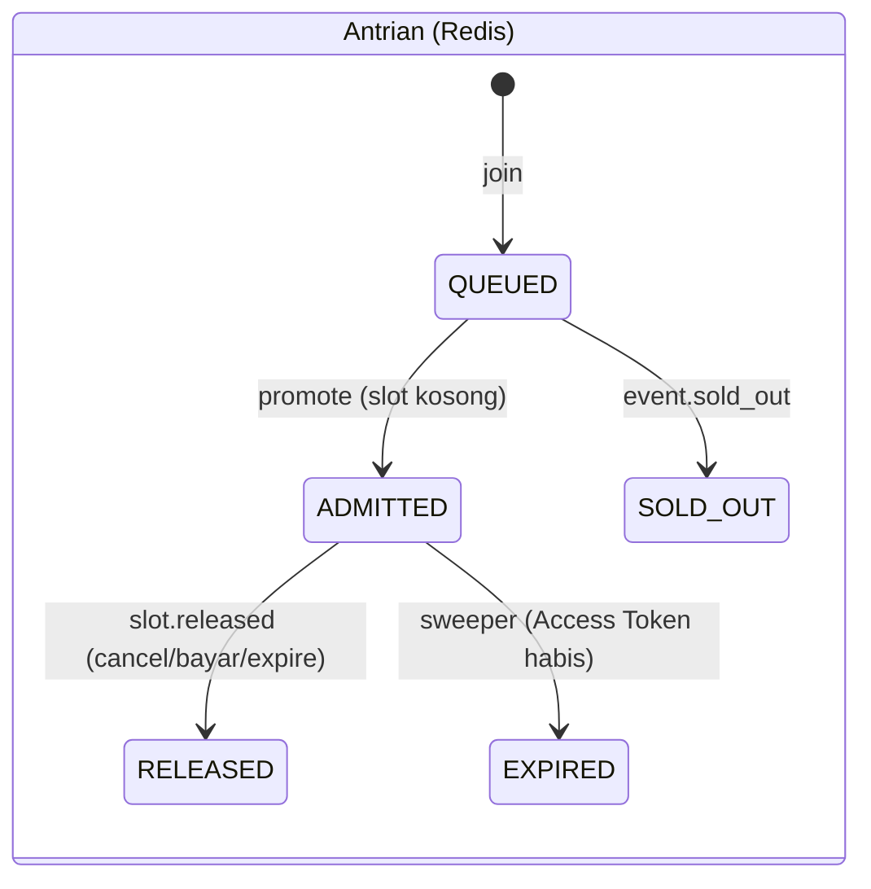
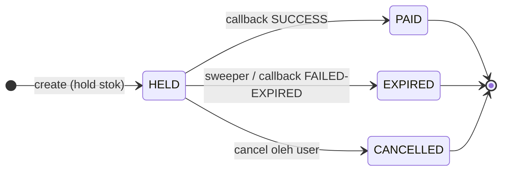

# LLD — Rusuh Booking Tiket

> Low Level Design: struktur kode, kontrak antar service, struktur data di Redis/Kafka, dan algoritma kritikal.
> Gambaran besar ada di [HLD.md](HLD.md). Skema tabel di [ERD.md](ERD.md). Kontrak HTTP di [openapi.yaml](openapi.yaml).

---

## 1. Struktur kode (sama di semua service)

Setiap service adalah repo & module Go sendiri (`go 1.26`), arsitektur **Hexagonal (Ports & Adapters)** per domain.
HTTP memakai `net/http` + `http.ServeMux` standar (pola `"METHOD /path"`), tanpa framework router.

```
<service>/
├── cmd/main.go                 # load config → logger → klien infra → delivery.New → middleware → serve + graceful shutdown
├── internal/
│   ├── config/                 # Config + Load() dari env (.env via godotenv)
│   ├── delivery/server.go      # composition root: rangkai adapter → usecase → handler, daftar route
│   └── <domain>/
│       ├── port/inbound/       # interface yang DITAWARKAN (usecase)
│       ├── port/outbound/      # interface yang DIBUTUHKAN (repo DB, cache, Kafka, klien HTTP)
│       ├── domain/             # entity, dto (+validasi), error code — tidak mengimpor infrastruktur
│       ├── application/usecase # logika bisnis, hanya bergantung ke port
│       └── infrastructure/     # adapter: http (handler, SSE, klien keluar), db (pgx), cache (Redis), event (Kafka)
├── pkg/                        # utilitas tanpa domain knowledge: apinizer (envelope), apperror, middleware, otel, kafka, ...
└── migrations/                 # SQL versioned (service yang punya tabel)
```

Aturan dependency: `infrastructure → application → domain`; usecase hanya mengenal **port** (interface), sehingga bisa diuji dengan mock.

### 1.1 Envelope response & error

```json
{ "status": "00000", "message": "OK", "data": { } }        // sukses, HTTP 200
{ "status": "409",   "message": "...", "data": { } }        // gagal, status = kode HTTP
```

Usecase mengembalikan `apperror.AppError{Code, Message}`; adapter HTTP memetakan `Code → HTTP status`:

| Code | HTTP |
|---|---|
| `VALIDATION_ERROR`, `NIK_INVALID` | 400 |
| `UNAUTHORIZED`, `TOKEN_INVALID` | 401 |
| `FORBIDDEN` | 403 |
| `NOT_FOUND` | 404 |
| `STOCK_UNAVAILABLE`, `QUOTA_EXCEEDED`, `BOOKING_ALREADY_PAID` | 409 |
| `TOKEN_EXPIRED`, `BOOKING_EXPIRED`, `SOLD_OUT` | 410 |
| `RATE_LIMITED` | 429 |
| `QUEUE_FULL` | 503 |

Transaction ID dikirim di header `X-Transaction-Id`.

### 1.2 Rantai middleware (luar → dalam)

`SecurityHeaders → CORS → MaxBody(1 MB) → OpenTelemetry → RequestLogger → mux`
(+ `OptionalAuth` / `RequireAccessToken` / `RequirePaymentToken` / `RequireRole("admin")` per route).

CORS mengizinkan header: `Content-Type, Authorization, X-Access-Token, X-Guest-Session-ID, X-Payment-Token, X-Transaction-Id, Cache-Control, Last-Event-ID, Accept`.
Batas body diletakkan di dalam CORS supaya respons `413` tetap membawa header CORS.

---

## 2. Rincian per service

### 2.1 queue-service (:8084)

| Route | Auth | Keterangan |
|---|---|---|
| `POST /api/queue/v1/event/{eventId}/join` | — | Rate limit per IP (`QUEUE_JOIN_RATE_PER_MIN`) |
| `GET /api/queue/v1/event/{eventId}/{queueToken}` | — | Status (dipakai saat refresh) |
| `GET /api/queue/v1/event/{eventId}/{queueToken}/stream` | — | SSE: `position`, `admitted`, `sold_out`, `expired`, `error` |

**Key Redis** (semua memakai hash tag `{eventId}` supaya satu slot):

| Key | Tipe | Isi |
|---|---|---|
| `queue:{e}` | ZSET | Antrian: member = queueToken, score = nomor urut |
| `admitted:{e}` | ZSET | Booking room: member = queueToken, score = expiresAt (ms) |
| `admission:{e}` | STRING | Jumlah orang di booking room |
| `stock:{e}` | HASH | Cache stok per kategori (warm-up dari PostgreSQL, lalu ikut `stock.changed`) |
| `admission:log:{e}` | log | Riwayat waktu admit untuk menghitung laju (ETA) |
| `queue:seq:{e}` | STRING | Mesin nomor urut (INCR) |
| `queue:closed:{e}` | STRING | Penanda sold out |
| `queue:token:{e}:{token}` | HASH | Status per token (`QUEUED/ADMITTED/RELEASED/EXPIRED/SOLD_OUT`, `expiresAt`), TTL 6 jam |
| `queue:events` | SET | Event yang punya antrian aktif (untuk sweeper) |
| `queue:notify:*` | Pub/Sub | Membangunkan koneksi SSE saat ada perubahan |

**Skrip Lua atomik** (`infrastructure/cache/scripts.go`):
- `join` — tolak bila ditutup (`SOLD_OUT`) atau antrian penuh (`QUEUE_FULL`); setiap join menerbitkan queue token baru, masuk antrian, lalu `promote` (bisa langsung `ADMITTED`).
- `promote` — selama `admission < CapByStock(sum(stock), GLOBAL_BOOKING_CAP)`, ambil dari depan antrian → `ADMITTED`, set `expiresAt = now + BOOKING_TTL`, catat ke log.
- `release(token)` — hanya bila status masih `ADMITTED`: hapus dari `admitted`, kurangi `admission`, lalu `promote`.
- `sweep` — lepas semua token di `admitted` yang `expiresAt` sudah lewat (status `EXPIRED`), lalu `promote`. Dijalankan tiap `QUEUE_SWEEP_INTERVAL_MS` (1 detik).

Rumus kapasitas (`domain/entity/queue.go`, identik dengan versi Lua dan dijaga test):

```go
func CapByStock(stock, globalCap int) int {
    switch { case stock <= 0: c = 0; case stock <= 3: c = 1; default: c = stock / 3 }
    if globalCap > 0 && c > globalCap { c = globalCap }
    return c
}
```

**Access Token** (HS256, `ACCESS_TOKEN_SECRET`): `{eventId, queueToken, bookingTtlExpiresAt, iss: queue-service, exp}`.

**Konsumen Kafka**: `stock.changed` → perbarui `stock:{e}` lalu promosi; `slot.released` → bila ada `queueToken` panggil `release`, bila tidak cukup `promote`;
`event.sold_out` → tutup antrian, kirim SSE `sold_out`, bersihkan.

### 2.2 booking-service (:8081)

| Route | Auth | Keterangan |
|---|---|---|
| `POST /api/booking/v1/create` | Access Token (+ JWT opsional) | Buat booking `HELD` |
| `GET /api/booking/v1/{bookingId}` | Payment Token (bookingId harus cocok) | Status, `remainingSeconds`, `backDisabled` (< 30 detik) |
| `POST /api/booking/v1/{bookingId}/cancel` | Payment Token (bookingId harus cocok) | Cancel |
| `GET /api/booking/v1/event/{eventId}/stock/stream` | Access Token | SSE stok |

**CreateBooking** (`application/usecase/create_booking.go`):

1. `eventId` body harus sama dengan klaim Access Token; TTL booking belum lewat.
2. Queue token tidak boleh ada di `queue:revoked:{token}` (sudah cancel → harus antri ulang).
3. Setiap penonton diverifikasi ke dukcapil-mock (`POST /api/dukcapil/v1/verify`). `DUKCAPIL_FAIL_OPEN` menentukan perilaku saat dukcapil tidak terjangkau.
4. Total tiket ≤ 3.
5. Dalam **satu transaksi** PostgreSQL:
   - Untuk tiap NIK: `pg_advisory_xact_lock(hashtextextended(event||':'||nik))` lalu hitung tiket NIK itu di booking `HELD/PAID`; > 1 → `QUOTA_EXCEEDED`.
   - Hold stok: `UPDATE ticket_category SET available = available - $1 WHERE id = $2 AND available >= $1`; 0 baris → `STOCK_UNAVAILABLE`.
   - Insert `booking` (`HELD`, `payment_expires_at = now + 10m`) dan `booking_item` (harga di-snapshot).
6. Terbitkan **Payment Token** (HS256, `PAYMENT_TOKEN_SECRET`, `{bookingId, eventId}`, `exp = paymentExpiresAt`).
7. Simpan queue token di `booking:qt:{bookingId}` (untuk cancel setelah Access Token habis).
8. Setelah commit (background): `booking.created`, `stock.changed` (reason `HOLD`, angka available aktual), Redis Pub/Sub `stock:{eventId}`.

**CancelBooking** (`cancel_booking.go`, `infrastructure/db/booking_repo.go`):

```
BEGIN
  SELECT event_id, status FROM booking WHERE id = $1 FOR UPDATE
  CANCELLED → selesai (idempoten) | PAID → 409 | EXPIRED → 410
  ada payment SUCCESS → 409
  UPDATE payment SET status='EXPIRED' WHERE booking_id=$1 AND status='PENDING'
  UPDATE booking SET status='CANCELLED' WHERE id=$1 AND status='HELD'   -- harus tepat 1 baris
  kembalikan stok per kategori dari booking_item
COMMIT
→ SET queue:revoked:{queueToken} (10 menit)
→ background: slot.released{reason: CANCELLED, queueToken}, stock.changed{RELEASE}, Pub/Sub stok, deteksi sold out
→ bila tadi ada payment PENDING: POST Midtrans /v2/{bookingId}/expire (404/407 dianggap sukses)
```

**Sweeper** (tiap 30 detik): booking `HELD` dengan `payment_expires_at < now()` (`FOR UPDATE SKIP LOCKED`) → `EXPIRED` + kembalikan stok.
Bila baris sudah tidak `HELD` (mis. keburu dibayar), tidak ada stok yang dilepas dan tidak ada event dipublish.

**SSE stok**: kirim snapshot dari DB saat connect, lalu kumpulkan pesan Redis Pub/Sub dan kirim satu frame batch tiap 1 detik (hanya bila ada perubahan);
heartbeat tiap 30 detik; frame `soldOut` lalu stream ditutup.

### 2.3 payment-service (:8083)

| Route | Auth | Keterangan |
|---|---|---|
| `GET /api/payment/v1/booking/{bookingId}` | Payment Token | Detail bayar untuk web & WebView (total, sisa waktu, redirect URL) |
| `POST /api/payment/v1/charge` | Payment Token | Buat transaksi Snap (idempoten: payment `PENDING` yang ada dipakai ulang) |
| `POST /api/payment/v1/callback` | — (signature di body) | Webhook Midtrans |

**Charge**: booking harus `HELD` dan belum lewat batas bayar → Snap `order_id = bookingId`, expiry Snap = sisa detik bayar → simpan `payment(PENDING, snap_token)`
dan `payment:redirect:{bookingId}` di Redis (TTL = sisa waktu).

**Callback**:
1. Verifikasi `signature_key = sha512(order_id + status_code + gross_amount + server_key)` (dilewati bila server key kosong — mode lokal).
2. `INSERT payment_callback_log(order_id:transaction_status) ON CONFLICT DO NOTHING` → sudah ada = selesai (idempoten).
3. Peta status: `settlement` / `capture+accept` → `SUCCESS`; `deny/cancel/failure` → `FAILED`; `expire` → `EXPIRED`; `pending` → `PENDING`.
4. `gross_amount` harus sama dengan total `price_snapshot`.
5. Update payment + booking dalam satu transaksi (booking `EXPIRED/CANCELLED` tidak ditimpa).
6. Bila booking snapshot **bukan `HELD`**: berhenti di sini (tanpa event). `SUCCESS` untuk booking tertutup → log ERROR “needs manual refund (CS)”.
7. Selain itu: `SUCCESS` → `payment.succeeded` + `slot.released{PAID}`; `FAILED/EXPIRED` → `payment.expired` + `slot.released{PAYMENT_TTL}`.

**Sweeper** (tiap 60 detik): payment `PENDING` yang batas bayarnya lewat → payment & booking `EXPIRED`, publish `payment.expired` + `slot.released`.

### 2.4 event-service (:8082)

| Route | Auth |
|---|---|
| `GET /api/event/v1/list?page&size` | publik (menyembunyikan `draft`/`closed`) |
| `GET /api/event/v1/detail/{eventId}` | Access Token |
| `GET /api/event/v1/admin/list-event` | JWT admin |
| `POST /api/event/v1/admin/create-event` | JWT admin |
| `PUT /api/event/v1/admin/update-event/{eventId}` | JWT admin |
| `DELETE /api/event/v1/admin/delete-event/{eventId}` | JWT admin (soft delete → `closed`) |
| `POST /api/event/v1/admin/{eventId}/create-category` | JWT admin (`available = capacity`) |
| `PUT /api/event/v1/admin/update-category/{categoryId}` | JWT admin |
| `POST /internal/event/v1/{eventId}/sold-out` | internal (dipanggil booking-service) |

### 2.5 user-service (:8086) & dukcapil-mock (:8085)

| Route | Auth |
|---|---|
| `POST /auth/register`, `POST /auth/login` | — (rate limit) |
| `POST /auth/logout` | `refreshToken` opsional (dicabut via `revoked:refresh:*`) |
| `GET /auth/me` | JWT |
| `POST /api/user/v1/nik/verify` | — (rate limit per IP & per NIK; 503 bila Dukcapil mati) |
| `GET/POST/PUT/DELETE /api/user/v1/member/...` | JWT; data NIK dicocokkan ke Dukcapil (fail-closed) |
| `GET /api/user/v1/ticket-history` | JWT |
| `POST /api/dukcapil/v1/verify` (dukcapil-mock) | — (internal) |

Login JWT (HS256, `USER_JWT_SECRET`): `{sub: userId, role}`; TTL default 1 jam; refresh token terpisah (`REFRESH_TOKEN_SECRET`).
Akun admin dibuat sekali saat start dari `ADMIN_EMAIL` + `ADMIN_PASSWORD`.
Dukcapil mencocokkan 4 field tanpa membedakan huruf besar/kecil (`strings.EqualFold` + `TrimSpace`).

### 2.6 worker-service (:8080, hanya `/healthz`)

Konsumen `booking.created`, `payment.succeeded`, `payment.expired` (+ topic `.retry`). Gagal kirim → publish ke `.retry` dengan backoff 5s/10s/20s;
setelah 3 kali → `.dlt`. Email e-tiket idempoten per `bookingId`. Template: instruksi bayar, e-tiket (per NIK), pembatalan.

---

## 3. Kontrak event Kafka

Key pesan = `eventId` (partisi per event → urutan terjaga per event).

| Topic | Producer | Consumer | Payload |
|---|---|---|---|
| `booking.created` | booking | worker | `{bookingId, eventId, eventName, email, items[{categoryId, categoryName, nik, name, price}], totalAmount, paymentExpiresAt}` |
| `stock.changed` | booking | queue | `{eventId, categoryId, delta, available, reason: HOLD\|RELEASE\|PAID}` |
| `slot.released` | booking, payment | queue | `{bookingId, eventId, reason: PAID\|BOOKING_TTL\|PAYMENT_TTL\|CANCELLED, queueToken?}` |
| `payment.succeeded` | payment | worker | `{bookingId, eventId, eventName, email, items[...]}` |
| `payment.expired` | payment | worker | `{paymentId?, bookingId, eventId, eventName?, email?}` |
| `event.sold_out` | booking, payment, event | queue | `{eventId}` |
| `*.retry`, `*.dlt` | worker | worker / manual | pesan asli + header `X-Retry-Count` |

Semua publish dilakukan **setelah commit** dan bersifat best-effort: gagal publish dicatat di log, tidak membatalkan transaksi.

---

## 4. State machine





Payment: `PENDING → SUCCESS | FAILED | EXPIRED` (cancel mengubah `PENDING → EXPIRED`).

---

## 5. Konfigurasi penting

| Env | Service | Default | Catatan |
|---|---|---|---|
| `ACCESS_TOKEN_SECRET` | queue, event, booking, payment | — | Harus sama |
| `PAYMENT_TOKEN_SECRET` | booking, payment | — | Harus sama |
| `USER_JWT_SECRET` | user, event, booking | dev default | Harus sama |
| `BOOKING_TTL_SECONDS` | queue | 300 | Umur Access Token / kursi booking room |
| `GLOBAL_BOOKING_CAP` | queue | 1000 | Plafon orang di booking room per event |
| `QUEUE_CAP` | queue | 100000 | Panjang antrian maksimum |
| `QUEUE_SSE_TICK_SECONDS` | queue | 2 | Interval cek ulang + heartbeat SSE |
| `QUEUE_SWEEP_INTERVAL_MS` | queue | 1000 | Interval sweeper kursi |
| `QUEUE_JOIN_RATE_PER_MIN` | queue | 30 | Rate limit join per IP (0 = mati) |
| `DUKCAPIL_FAIL_OPEN` | booking | true | `false` = NIK wajib cocok |
| `MIDTRANS_SERVER_KEY`, `MIDTRANS_ENV` | payment, booking | —, sandbox | Booking memakainya untuk expire saat cancel |
| `OTEL_ENABLED`, `OTEL_SAMPLE_RATIO` | semua | true | Matikan di lokal |

Daftar lengkap per service beserta contoh nilai lokal: [LOCAL-SETUP.md §4](LOCAL-SETUP.md#4-file-env-per-service).

---

## 6. Testing & quality gate

- Unit test co-located (`*_test.go`), table-driven, mock lewat port (gomock / fake); Redis diuji dengan miniredis, SQL dengan pgxmock / fake querier.
- Test kritikal: anti-oversell konkuren, kuota NIK, ekspirasi TTL, idempotensi callback, promosi FCFS, kesetaraan rumus kapasitas Go vs Lua, cancel.
- CI tiap PR: `go test -race` + coverage gate, golangci-lint (termasuk `depguard` untuk aturan layer), gosec, govulncheck.
