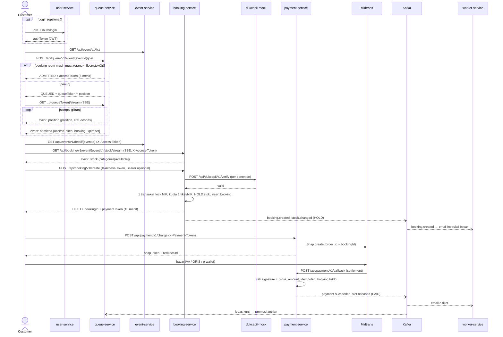
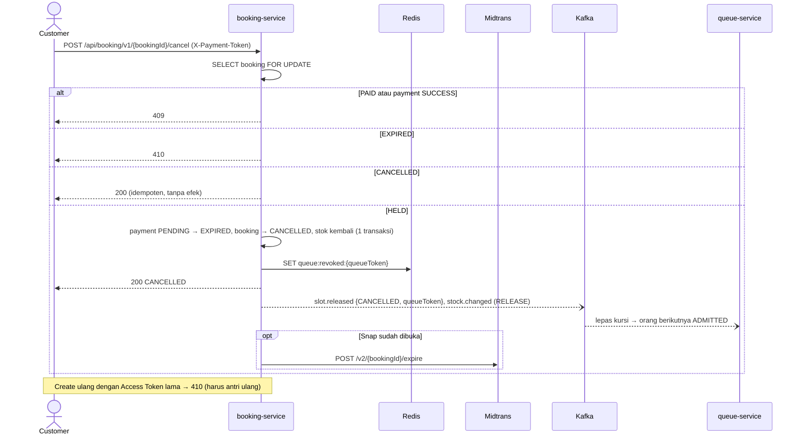
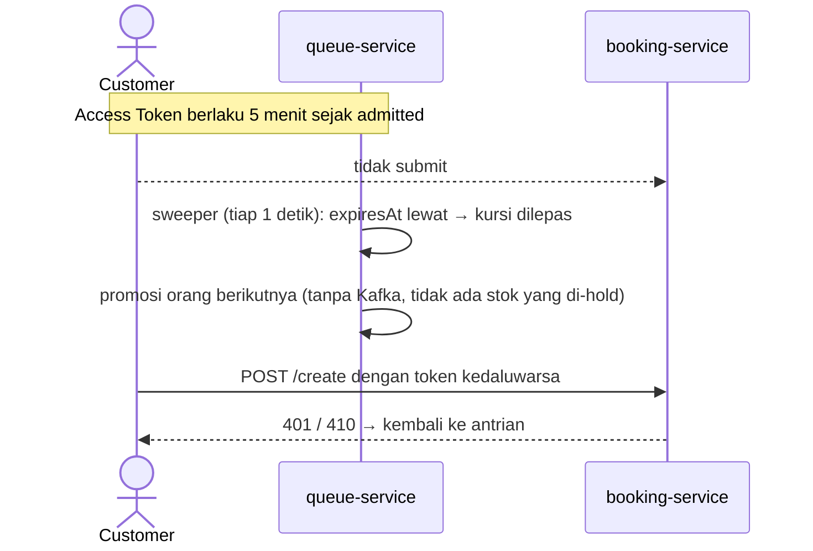
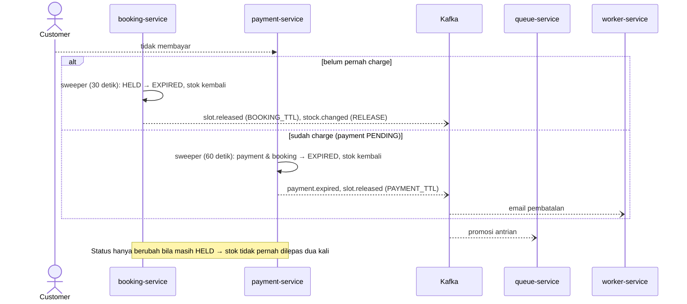
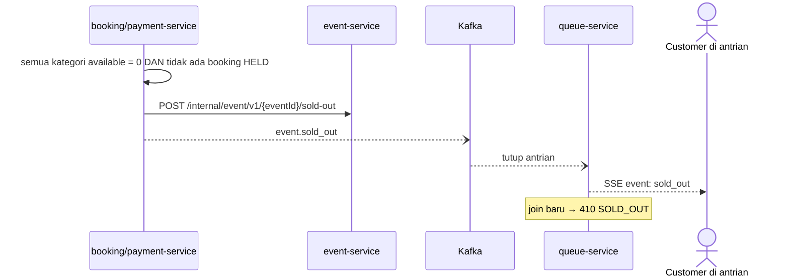
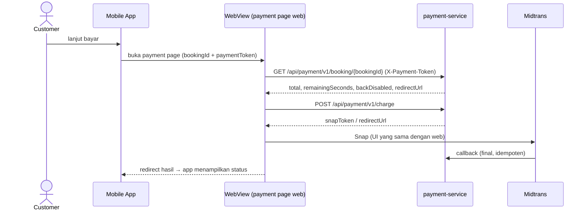

# Sequence Diagram — Rusuh Booking Tiket

> Semua endpoint di bawah lewat API Gateway (`https://<gateway>`). Base path & header lengkap ada di [openapi.yaml](openapi.yaml).

## 1. Alur utama: antrian → booking → bayar sukses

## 2. Cancel booking (user kembali dari Payment Page)

## 3. Access Token habis sebelum submit (idle di Detail Ticket)

## 4. Batas bayar 10 menit habis

## 5. Sold out → antrian ditutup

## 6. Pembayaran dari Mobile (WebView)

## 7. Kanal realtime

| Kanal | Endpoint | Event SSE | Ditutup saat |
|---|---|---|---|
| Posisi antrian | `GET /api/queue/v1/event/{eventId}/{queueToken}/stream` | `position`, `admitted`, `sold_out`, `expired`, `error`; heartbeat `: ping` | `admitted` / `sold_out` / `expired` |
| Stok per kategori | `GET /api/booking/v1/event/{eventId}/stock/stream` (header `X-Access-Token`) | `stock` (batch ≤ 1/detik); heartbeat 30 detik | `soldOut` |

Stream stok butuh header, jadi klien memakai SSE berbasis `fetch` (bukan `EventSource` bawaan browser). Lewat gateway, stream maksimal 3570 detik → klien auto-reconnect.
